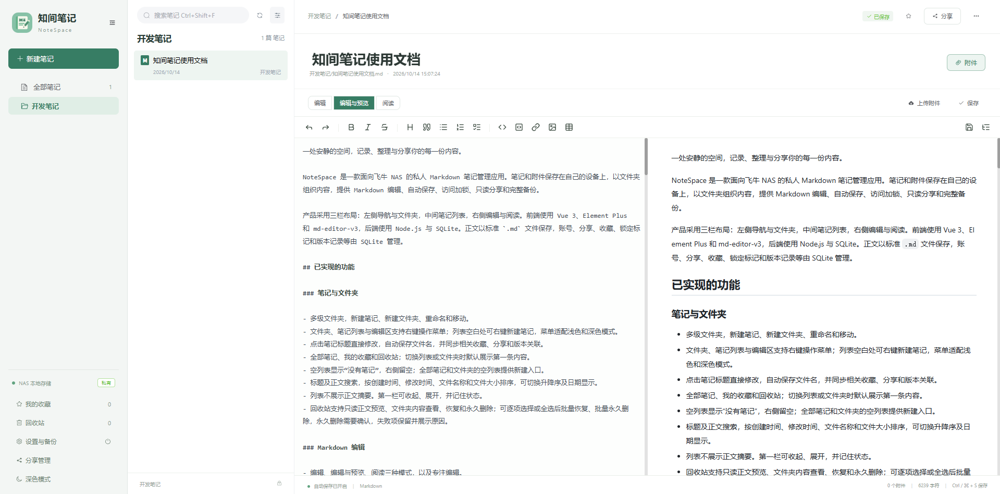
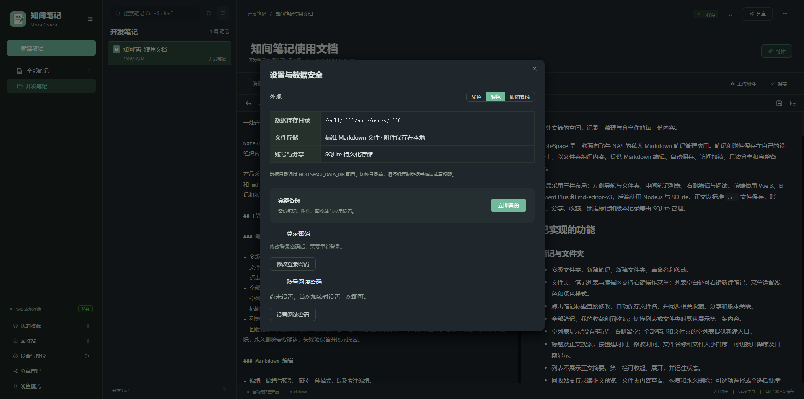
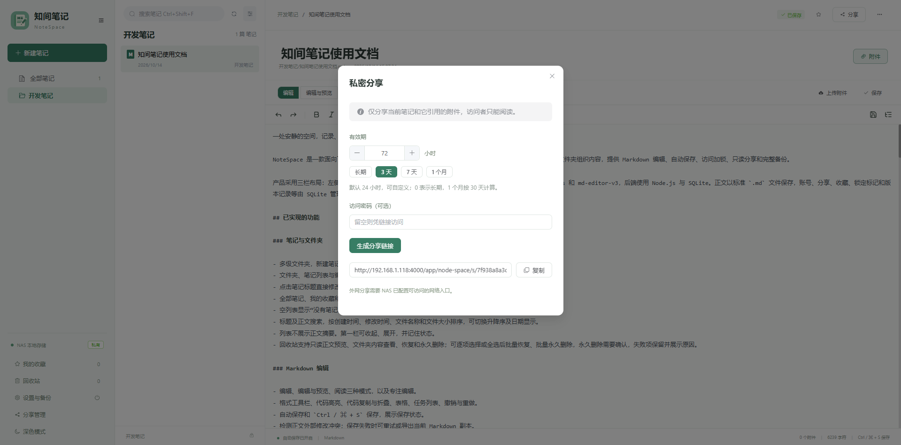
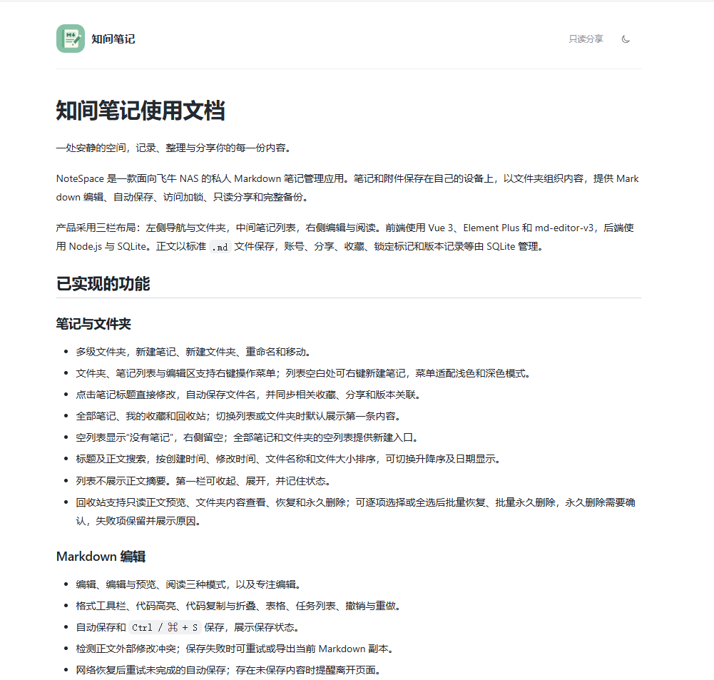

# 知间笔记 · NoteSpace

**知间笔记（NoteSpace）** 是一款专为飞牛 NAS 打造的轻量化、私有化 Markdown 笔记管理应用，致力于为用户提供安全、简洁、高效的个人知识管理空间。

**所有数据均保存在用户自己的飞牛 NAS 设备中，无需依赖任何外部云服务或第三方服务器。** 笔记正文、图片、附件、账号信息、分享配置及历史版本等数据均在本地存储和管理，真正实现数据自主掌控，保护个人隐私。

应用采用简洁直观的三栏布局，支持多级文件夹管理、Markdown 实时编辑、自动保存、笔记收藏、访问加锁、只读分享、历史版本管理及完整数据备份，让知识整理与内容创作更加轻松高效。

**核心特色：**
- **完全本地化：** 所有笔记、附件及应用数据均存储于飞牛 NAS，不依赖外部云端服务。
- **隐私与安全：** 数据由用户自主掌控，支持笔记加锁、密码保护及只读分享。
- **Markdown 编辑：** 支持标准 Markdown 语法，所见即所得，正文以 `.md` 文件保存，方便迁移和长期保存。
- **高效管理：** 多级文件夹、笔记收藏、自动保存及历史版本记录，让知识井然有序。
- **便捷分享：** 支持只读分享、访问密码及有效期设置，分享权限自主可控。
- **完整备份：** 支持笔记、附件及相关配置数据备份，降低数据丢失风险。

**技术架构：**

前端基于 Vue 3、Element Plus 和 md-editor-v3 构建，后端采用 Node.js + SQLite。笔记正文以标准 `.md` 文件存储，附件保存在 NAS 本地目录，SQLite 负责管理账号、分享权限、收藏、锁定状态及版本记录等元数据。

**无需注册第三方账号，无需连接外部云平台，无需额外部署数据库，安装到飞牛 NAS 即可使用。**

*让知识留在身边，让数据真正属于自己。*

- 项目地址：[hulupi/notespace](https://github.com/hulupi/notespace)
- FPK 下载：[GitHub Releases](https://github.com/hulupi/notespace/releases)

如果这个项目对你有帮助，欢迎点亮一个 ⭐ Star，感谢支持！
## 项目说明

本项目全程由 Codex AI 生成。如有侵权或其他不恰当的地方，请通过本仓库的 [Issues](https://github.com/hulupi/notespace/issues) 联系本人删除，谢谢！

## 界面截图







## 已实现的功能

### 笔记与文件夹

- 多级文件夹，新建笔记、新建文件夹、重命名和移动。
- 文件夹、笔记列表与编辑区支持右键操作菜单；列表空白处可右键新建笔记，菜单适配浅色和深色模式。
- 点击笔记标题直接修改，自动保存文件名，并同步相关收藏、分享和版本关联。
- 全部笔记、我的收藏和回收站；切换列表或文件夹时默认展示第一条内容。
- 空列表显示“没有笔记”，右侧留空；全部笔记和文件夹的空列表提供新建入口。
- 标题及正文搜索，按创建时间、修改时间、文件名称和文件大小排序，可切换升降序及日期显示。
- 列表不展示正文摘要。第一栏可收起、展开，并记住状态。
- 回收站支持只读正文预览、文件夹内容查看、恢复和永久删除；可逐项选择或全选后批量恢复、批量永久删除，永久删除需要确认，失败项保留并展示原因。

### Markdown 编辑

- 编辑、编辑与预览、阅读三种模式，以及专注编辑。
- 格式工具栏、代码高亮、代码复制与折叠、表格、任务列表、撤销与重做。
- 自动保存和 `Ctrl / ⌘ + S` 保存，展示保存状态。
- 检测正文外部修改冲突；保存失败时可重试或导出当前 Markdown 副本。
- 网络恢复后重试未完成的自动保存；存在未保存内容时提醒离开页面。
- 正文版本预览、手动记录和恢复。每篇最多保留 50 份，自动记录最多每分钟一次，恢复前保留当前正文。

### 附件

- 文件多选、拖拽上传、剪贴板图片上传，上传后插入当前笔记。
- 每个文件最大 **500MB**，使用文件流上传，前后端上传超时设为 30 分钟。
- 上传进度、失败提示、图片显示、附件列表及保留原文件名的下载。
- 附件访问校验所属笔记权限；分享访问仅开放分享正文引用的附件。

### 账号与阅读密码

- 飞牛部署按 NAS 用户 UID 隔离数据，每位用户拥有独立笔记空间和登录密码，不需要填写用户名。
- 登录密码和阅读密码均为 **6–20 位**，支持通过弹窗修改；退出登录需要二次确认。
- 一份账号阅读密码供全部加锁笔记和文件夹共用，文件夹保护其下的内容。
- 加锁文件夹在第二栏输入密码，第三栏留空；加锁笔记在第三栏输入密码，保留第二栏列表。
- 阅读密码解锁授权有效期为 30 分钟，可重新锁定或取消加锁。
- 忘记阅读密码时，可验证当前登录密码后重新设置。
- 当前浏览器标签内刷新时恢复所在列表、文件夹或笔记；待解锁位置会重新展示密码界面。

### 分享与外观

- 独立只读分享页面，支持分享密码、有效期和撤销。
- 分享有效期默认 24 小时，可自定义，提供长期、3 天、7 天、1 个月快捷项。
- 同一篇笔记使用固定分享标识，修改分享设置、重命名或移动保持链接；撤销后重新分享也沿用该链接。
- 独立分享管理界面，展示标题、已设置的分享密码、剩余时间、链接及操作。
- 浅色、深色和跟随系统三种外观，记住浏览器选择；编辑器、弹窗、预览和分享页同步适配。
- 手机端采用列表与内容页切换，文件夹导航通过抽屉打开。

### 数据安全与备份

- 密码使用 scrypt 加盐哈希，登录会话令牌以哈希保存。
- HttpOnly、SameSite 登录 Cookie，跨站写入检查、路径校验与 Markdown HTML 消毒。
- 手动完整备份笔记、附件、回收站及当前空间的数据库和配置。
- SQLite 使用在线备份接口；备份副本清除登录会话和解锁授权。
- 编辑器与高亮库随构建打包，基础编辑不依赖外部 CDN。

## 安装与启动

### 飞牛 NAS 安装

安装包声明的最低系统版本为 fnOS **1.1.3100**，依赖应用中心的 **nodejs_v22**。

1. 准备由当前源码生成的 `node-space-<版本号>.fpk`，在飞牛应用中心通过手动安装导入。
2. 按安装引导阅读功能介绍，并填写可选的数据保存目录，例如 `/vol1/1000/NoteSpace`。
3. 未填写时，使用系统分配的应用持久化目录 `TRIM_PKGVAR/data`。
4. 自定义目录需要应用账号的读写和上级路径访问权限。若启动提示权限不足，在飞牛应用设置中授予对应目录读写权限，包含子文件夹和文件。
5. 启动应用，从飞牛桌面打开知间笔记，首次设置该飞牛用户自己的 NoteSpace 登录密码。

飞牛入口为 `/app/node-space`，复用飞牛系统域名与访问端口，不额外开放应用的 `3210` 端口。后端通过 Unix Socket 接入统一网关，以网关注入的有效 UID 识别飞牛用户。

飞牛部署中，状态查询、注册和登录也需要飞牛身份；私人数据和操作还需该 UID 下有效的 NoteSpace 登录会话。分享页面与分享只读接口在应用层允许匿名访问，但能否免飞牛登录到达应用，取决于系统网关是否允许匿名转发这些分享路径。详见下方“使用边界”。

安装、目录授权和启动日志说明见 [飞牛安装包说明](fpk/README.md)。

### 本地开发调试

需要 Node.js **22.16 或更高版本**，包含内置 `node:sqlite`。在项目根目录执行：

```sh
npm install
npm run dev
```

打开终端输出的前端地址，默认是 `http://localhost:5173`。开发脚本同时启动前后端，后端源码变化时自动重启。

本地 TCP 模式不要求飞牛登录，忽略客户端提交的飞牛 UID Header，使用独立的 `local` 笔记空间；仍需设置并输入 NoteSpace 登录密码。默认数据目录为项目根目录下的 `data/`。

启动前请停止旧的 `npm start` 或开发服务，避免后端 `127.0.0.1:3210` 端口被占用。修改后端代码后，单独使用 `npm start` 的服务需要手动重启。

### 本地构建运行

```sh
npm run build
npm start
```

默认访问 `http://127.0.0.1:3210`。PowerShell 中可在启动前指定数据目录：

```powershell
$env:NOTESPACE_DATA_DIR = 'E:\NoteSpace'
npm start
```

Linux 中可使用：

```sh
NOTESPACE_DATA_DIR=/path/to/NoteSpace npm start
```

本地 TCP 运行与飞牛 FPK 部署是两种运行方式；飞牛安装请使用 FPK 的网关和用户隔离配置。

### 构建 FPK

安装项目依赖，并准备可执行的官方 `fnpack` 后，在项目根目录执行：

```sh
npm run pack
```

输出文件名自动读取 `fpk/manifest` 中的 `version`，例如 `version = 1.2.1` 时生成 `fpk/node-space-1.2.1.fpk`。脚本构建前端、复制后端和静态资源，并处理安装脚本换行与执行权限。同版本再次打包会替换对应文件，其它版本的安装包保留。Node.js 由飞牛的 `nodejs_v22` 依赖提供，无需设置 `NOTESPACE_NODE_RUNTIME`，也无需把 Windows 的 `node.exe` 放入安装包。

若 `fnpack` 未加入 PATH，可通过 `FNPACK` 环境变量指定其可执行文件路径。源码修改不会自动更新已有 FPK，安装新代码需要重新构建安装包。

### 发布到 GitHub Releases

先修改 `fpk/manifest` 的版本号，提交并推送对应源码，再执行 `npm run pack`。在 GitHub 仓库的 Releases 中创建新发布，选择该源码提交或对应的 `main` 分支，创建例如 `v1.2.1` 的标签，填写版本标题和更新说明，将 `fpk/node-space-1.2.1.fpk` 拖到附件上传区，等待上传完成后发布。

安装包作为 Release 附件上传即可，不需要修改 `.gitignore` 或提交二进制文件。版本号、标签和附件名称应保持对应，打包期间不要继续修改待发布源码。官方操作说明见 [GitHub Releases 文档](https://docs.github.com/en/repositories/releasing-projects-on-github/managing-releases-in-a-repository)。

## 使用说明

1. **创建与编辑**：选择文件夹后新建笔记，在第三栏输入正文；点击顶部标题可修改文件名，内容会自动保存。
2. **整理笔记**：通过文件夹或笔记操作菜单重命名、移动、收藏、加锁或移入回收站。搜索和排序位于第二栏顶部。
3. **添加附件**：使用编辑器上传入口、附件面板拖拽，或直接粘贴图片。上传完成后自动插入引用。
4. **设置访问保护**：在“设置与备份”中设置阅读密码，再为笔记或文件夹加锁。首次加锁也会引导设置密码。
5. **分享笔记**：为未加锁笔记设置有效期和可选密码，复制链接；在第一栏“分享管理”中修改或撤销分享。
6. **查看版本**：打开笔记操作菜单中的“正文版本”，选择历史正文预览，按需记录或恢复。
7. **备份数据**：进入“设置与备份”，解锁当前空间中所有加锁内容，包括回收站，然后执行完整备份。

修改登录密码会使当前空间的所有登录会话失效，需要重新登录；正常服务重启不会主动撤销仍在有效期内的会话。登录会话默认有效 12 小时。

## 数据保存与恢复

本地空间的数据目录结构：

```text
data/
├─ notes/          Markdown 正文
├─ attachments/    本地附件
├─ trash/          回收站内容
├─ backups/        手动备份
└─ .notespace/     SQLite 数据库与分享密码密钥等配置
```

飞牛部署按 UID 存放独立空间：

```text
<数据目录>/
├─ .notespace/          全局分享归属索引
└─ users/
   ├─ <UID 1>/         用户 1 的上述完整空间
   └─ <UID 2>/         用户 2 的上述完整空间
```

界面中的完整备份针对当前用户空间，**不是所有飞牛用户的统一备份**。

恢复时先停止应用，将选定备份中的 `notes/`、`attachments/`、`trash/`、`.notespace/` 复制到准备好的空空间目录，再确认目录权限并启动。飞牛部署需放回对应 UID 的空间目录，本地部署可通过 `NOTESPACE_DATA_DIR` 指定新目录。恢复包含登录密码、阅读密码和分享记录；登录会话需要重新建立，并应检查恢复后分享的有效期。

更换整个数据保存目录时，应停机复制完整目录并保留用户目录、数据库和密钥。不要只复制 `.md` 文件或单个 SQLite 文件；运行中的数据库可能还有 WAL 数据。应用未提供界面内一键恢复或在线迁移。

## 使用边界

### 身份与分享

- 飞牛身份仅在 Unix Socket 网关模式下采信，不能通过本地请求 Header 切换到其它飞牛用户空间。飞牛部署缺少 Socket 配置时拒绝回退到本地模式。
- 分享匿名访问是应用层能力。如果飞牛网关在转发前要求登录，还需要系统提供分享路径的匿名转发能力；不要将整个管理入口开放匿名，也不要为此直接公开应用 Socket。
- 分享访问只能读取指定笔记及其引用的附件，不能编辑或进入管理接口。加锁会撤销相关分享，受保护笔记即使当前已解锁也不能分享。
- 固定分享链接不是一次性链接。撤销后重新启用分享，之前持有该链接的人仍可能再次访问；需要限制访问时请配合分享密码与有效期。

### 加锁与文件权限

- 阅读密码属于应用访问控制，**不会加密磁盘上的正文、附件、SQLite 历史或备份**。可以直接读取 NAS 文件的系统账号仍可能读取内容。
- 登录密码、阅读密码与分享密码是不同用途的密码；分享密码不受阅读密码 6–20 位规则控制。
- 为了在分享管理中展示密码，分享密码另有可解密的存储副本，密钥保存在当前空间的 `.notespace/` 中；备份和迁移必须包含密钥，并保护其文件权限。
- 登录密码忘记后没有邮件找回功能；阅读密码重设需要验证登录密码。
- 应用账号运行所需的文件权限、磁盘加密与 NAS 系统安全由部署环境负责。用户隔离不能代替系统级文件权限。

### 保存、版本与附件

- 自动保存不等于多人协同编辑；应用不提供实时协作或自动合并冲突。出现保存冲突时先保留未保存文本，再读取最新内容。
- 版本管理只恢复正文，不回滚笔记标题或位置，也不是附件版本管理；历史仅保留最近 50 份。
- 页面中的未保存内容并非持久化离线草稿，关闭浏览器或设备异常可能丢失，应确认保存状态。
- 删除笔记不会自动删除附件，暂未提供孤立附件清理；回收站和备份也不会自动按期清理。
- 500MB 是应用的单文件上限，实际上传还受网关请求限制、连接超时、可用磁盘空间和网络速度影响。
- 正文等 JSON 请求仍有 24MB 请求体上限，不能把附件的 500MB 上限理解为正文大小上限。

### 备份与部署

- 手动备份默认保存在同一存储中，不能覆盖磁盘损坏风险，应另行复制到其它设备。
- 同一数据目录由一个服务实例独占，不支持多个服务并发使用同一目录。
- 不提供旧版 JSON 数据迁移，也不会自动将旧的单用户根目录数据分配给飞牛账号。
- 暂未实现自动备份、定时清理、栏宽拖动、在线迁移和一键恢复。
- 当前说明对应源码能力，不代表已在所有 fnOS 版本、NAS 架构、代理配置和手机浏览器上完成验证。

## 项目目录

```text
backend/       后端 API、SQLite、文件存储与权限校验
frontend/      Vue 3 界面、编辑器与主题样式
dist/          前端构建产物
fpk/           飞牛安装包配置、安装引导及生命周期脚本
scripts/       开发启动、模板整理与打包脚本
package.json   依赖与运行命令
README.md      项目介绍与使用说明
```

前端源码按职责组织，不包含独立语言包：

```text
frontend/src/
├─ api/          请求客户端与附件上传
├─ assets/       Logo 等静态资源的统一入口
├─ components/   右键菜单、分享管理等公共组件
├─ layouts/      笔记工作区布局与交互
├─ router/       工作区和分享页的入口选择
├─ stores/       主题等共享状态
├─ styles/       全局样式
├─ utils/        保存队列、附件解析、HTML 消毒等工具
├─ views/        工作区与分享页面
├─ App.vue       应用根组件
├─ main.ts       应用启动入口
└─ env.d.ts      Vite 与 Vue 文件类型声明
```
